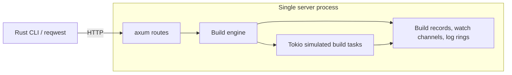
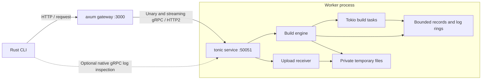
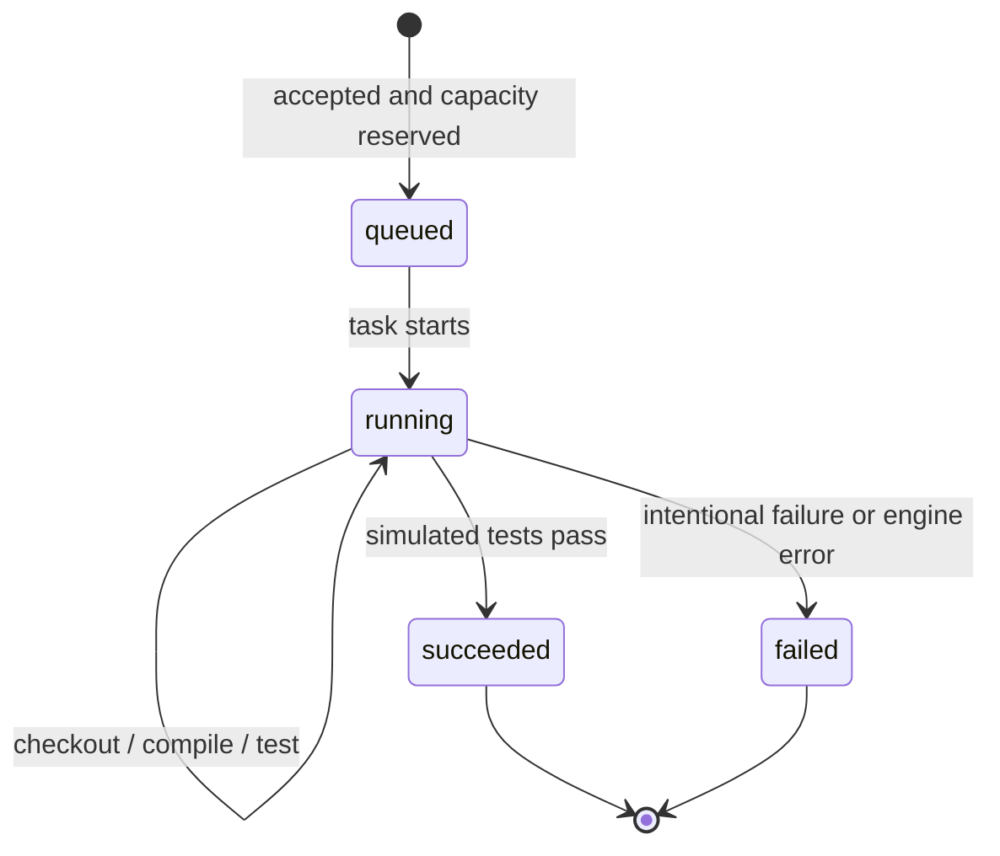
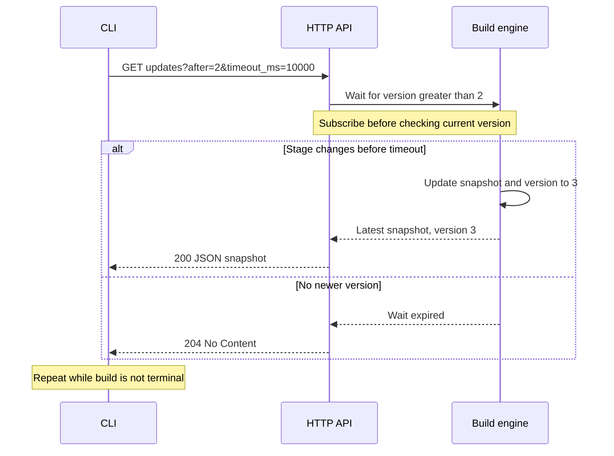
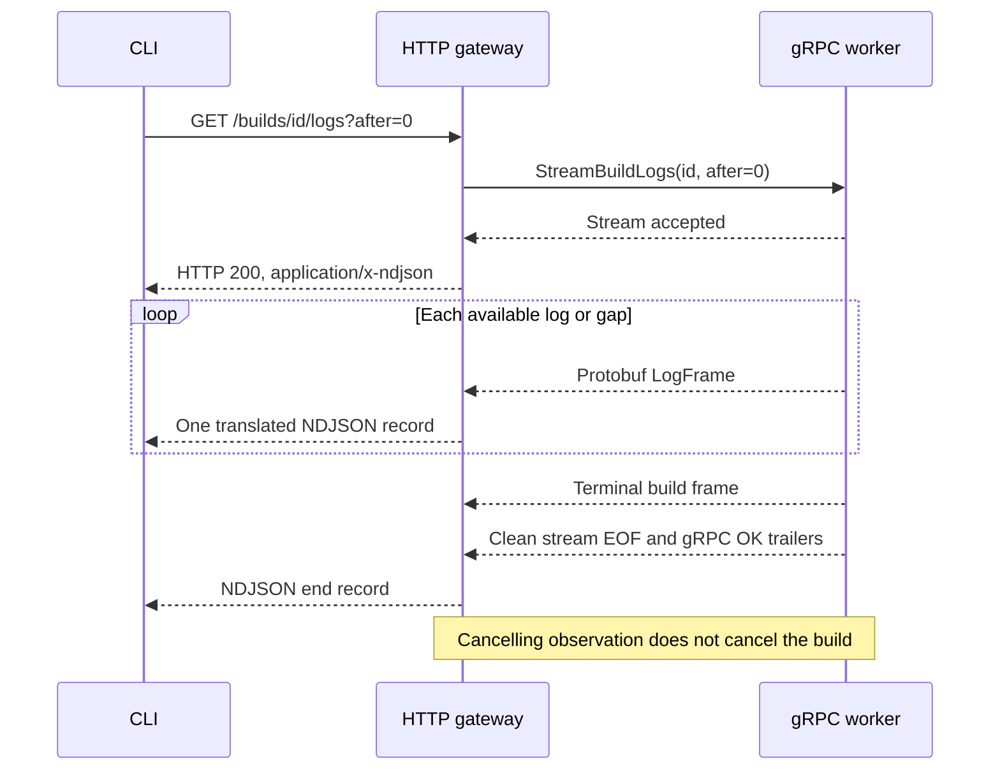
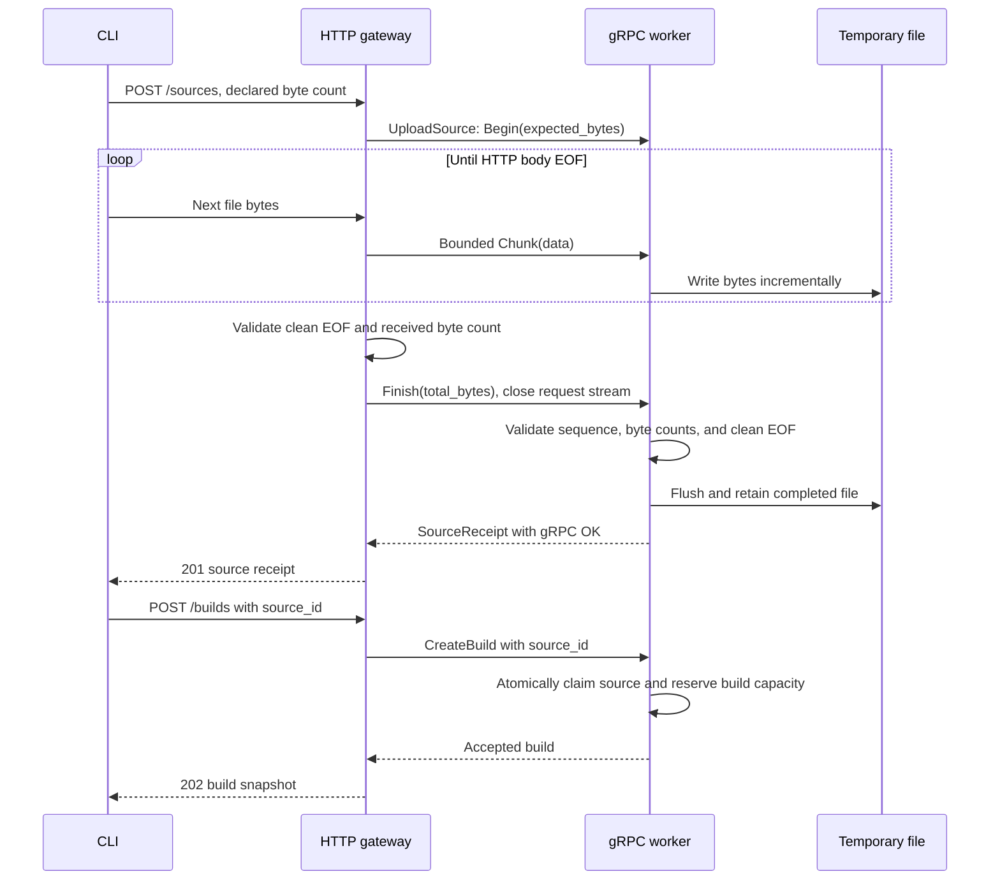

# Pocket CI Design Specification

**Status:** proposed architecture, not implemented functionality.

Pocket CI is a local, simulated CI build service. This specification describes how one small application evolves from an HTTP server into an HTTP gateway with a gRPC worker. See [README.md](README.md) for the product story and learning milestones.

## 1. Goals and Non-Goals

Goals:

- Deliver useful features at every milestone: submit, inspect, wait, tail, and upload.
- Learn HTTP basics, long polling, HTTP streaming, gRPC streaming, and incremental protocol conversion through those features.
- Keep application memory bounded and make cancellation and failure behavior explicit.
- Preserve the public HTTP API when execution moves into a worker.
- Produce a small, testable Rust project and a publishable tutorial.

Non-goals: real builds, running shell commands or uploaded code, archive extraction, distributed scheduling, databases, durable delivery, authentication, TLS deployment, gRPC-Web, and full-duplex HTTP. Do not expose the unauthenticated tutorial service beyond loopback.

## 2. Architecture Evolution

### Initial Architecture: Milestones 1-3

The API process owns the build engine. Network handlers call ordinary domain functions; there is no gRPC dependency yet.



### Final Architecture: Milestones 4-6

Move the build engine and its state into the worker. HTTP routes become adapters to generated tonic clients; they do not maintain a second copy of build state.



| Component | Responsibility | Planned tools |
| --- | --- | --- |
| CLI | Commands, HTTP/gRPC clients, incremental decoding, terminal output | `clap`, `reqwest`, `tonic` |
| API/gateway | HTTP validation, error mapping, stream translation | `axum`, `tokio`, `serde`, `async-stream` |
| Worker | Admission, build lifecycle, status, log retention, source files | `tonic`, `tokio` |
| Shared contract | Domain DTOs, protobuf schema, framing bounds | `serde_json`, `prost`, `tonic-prost` |

Use `tonic-prost-build` as a build dependency for protobuf generation. A vendored `protoc`, configured through an explicit executable path, avoids manual installation and unsafe environment mutation on Rust edition 2024. Select compatible crate versions during implementation rather than treating this document as a dependency lockfile.

Default listeners are `127.0.0.1:3000` and `127.0.0.1:50051`. Make addresses configurable. Reuse reqwest clients and cloneable tonic channels; do not hold a global client mutex during an RPC or stream. An unavailable worker produces a gateway error, not a gateway startup failure.

## 3. Domain Model and Ownership

| Type | Important fields | Meaning |
| --- | --- | --- |
| `BuildRequest` | `label`, `fail_tests`, optional `source_id` | Simulated build configuration |
| `BuildSnapshot` | `id`, `label`, `state`, `stage`, `version`, optional `source_id` | Latest observable status |
| `LogLine` | `seq`, `stage`, `text` | One bounded log message |
| `BuildRecord` | Snapshot, status notifications, log ring, log notifications | Worker-owned live record |
| `SourceReceipt` | `source_id`, `bytes` | A completely received, temporarily stored input |

Build identifiers are opaque strings at the API boundary, issued by the engine. Use a fresh process-generation prefix plus a counter so restarting the worker does not alias an old identifier to a new build. Data remains process-local: restart or eviction makes old identifiers return `404`.

Status versions and log sequences are separate counters. Status version starts at `1` and changes on stage/state transitions. Log sequence starts at `1` and advances on each line; cursor `0` means no lines have been consumed. Neither is a timestamp.



`queued` is a brief accepted state, not an unbounded job queue. The service reserves execution capacity before accepting work. A demo emits roughly 12 log lines over eight seconds.

Service-owned tasks execute builds independently of request lifetime. Log viewers and long-poll requests are observers only. Use short critical sections to update state and publish notifications consistently; never hold a lock or watch borrow across `.await` or a stream yield. Record final status even when the simulated engine fails.

## 4. Public HTTP API

| Method and path | Input | Successful response |
| --- | --- | --- |
| `POST /builds` | JSON `BuildRequest` | `202`, snapshot, `Location: /builds/{id}` |
| `GET /builds/{id}` | Build ID | `200`, latest snapshot |
| `GET /builds/{id}/updates` | `after`, optional `timeout_ms` | `200` newer snapshot, or `204` timeout |
| `GET /builds/{id}/logs` | Optional `after`, default `0` | `200`, streamed NDJSON |
| `POST /sources` | Raw bytes, `X-Source-Bytes` | `201`, source receipt |

Example build request:

```json
{"label":"failing-demo","fail_tests":true}
```

Example accepted snapshot:

```json
{"id":"session-a-1","label":"failing-demo","state":"queued","stage":"pending","version":1,"source_id":null}
```

State may already have advanced when a subsequent GET runs. `202` confirms admission only. Failed tests produce a `failed` build state; they are not an HTTP or gRPC transport error.

Require valid JSON and supported content types. Limit build JSON to 4 KiB and label text to 256 UTF-8 bytes. Unknown IDs return `404`; malformed parameters return `400`; unsupported content types return `415`; admission exhaustion returns `429`. Claim a source receipt atomically with accepting a build; reused or expired receipts return `409`. Do not claim the source when admission fails.

Use a small JSON error envelope such as `{"error":{"code":"worker_unavailable","message":"Build worker is unavailable"}}`. No internal stack traces or filesystem paths in public errors.

## 5. Long Polling

`after` is required and contains the last observed status version. If the current version is newer, return it immediately. If equal, wait; if the cursor is ahead of current state, reject it with `400`. Default wait is 10 seconds; accepted waits range from 1 ms to 30 seconds.



Implementation algorithm: subscribe to Tokio `watch`, clone `borrow_and_update()`, compare the version, and await `changed()` only if necessary. Repeat the comparison under one overall timeout, not a fresh timeout per notification. This avoids a missed update between checking state and waiting.

`watch` retains the latest snapshot, so intermediate transitions may be coalesced. The CLI exits on a terminal snapshot, reconnects after `204`, and backs off on transport failures. An equal terminal cursor still follows the ordinary timeout contract.

After worker extraction, the gateway calls a delayed unary `WaitBuildUpdate` RPC. It must not implement long polling by repeatedly issuing hidden `GetBuild` requests. Give the RPC a deadline slightly longer than the requested wait so a normal wait expiration returns `204`, not a transport timeout.

## 6. Live Logs and Replay

Return `Content-Type: application/x-ndjson` and `Cache-Control: no-store`. Each JSON record ends with a newline. Do not add compression, manually set `Transfer-Encoding`, or set a total response `Content-Length`; the HTTP implementation handles transfer framing.

HTTP/1.1 commonly uses chunked transfer for unknown-length bodies. HTTP/2 uses DATA frames, not chunked transfer encoding. In both cases, transport chunks can split or combine application records.

The HTTP stream has four tagged frame types:

```json
{"type":"log","seq":1,"stage":"checkout","text":"Checking out simulated source"}
{"type":"gap","from":2,"to":9}
{"type":"log","seq":10,"stage":"test","text":"Simulated test failed"}
{"type":"end","state":"failed","last_seq":10}
```

On a transport/backend failure, send an `error` frame instead of normal `end`:

```json
{"type":"error","code":"worker_unavailable","message":"Worker connection was lost"}
```

`after=N` requests lines with `seq > N`. Keep the last 128 log lines per build. If requested lines were evicted, emit an inclusive `gap` range and continue with retained history. A future cursor returns `400` before response headers are sent.

Subscribe to log-generation notifications before inspecting the ring. Under a short lock, inspect the cursor and copy only the next bounded line or gap; release the lock before yielding or waiting. Build completion also wakes log observers. Once the build is terminal, drain retained lines and emit `end`.

The CLI incrementally decodes bytes using a maximum 8 KiB NDJSON record. It handles split UTF-8 bytes, split records, and multiple records in one body chunk. It advances its cursor after processing lines or gaps. Normal completion requires `end`; an `error` frame or EOF without `end` is a stream failure.

Slow readers must not stall the build engine. The ring may overwrite old output, and readers receive gaps instead of unlimited buffering. This is bounded replay, not durable or lossless log storage.

## 7. gRPC Contracts and Log Translation

The proposed `BuildWorker` service has these RPC shapes:

| RPC | Shape | Purpose |
| --- | --- | --- |
| `CreateBuild` | Unary | Admit a build and return a snapshot |
| `GetBuild` | Unary | Read latest status |
| `WaitBuildUpdate` | Unary, delayed | Return newer snapshot or explicit wait-expired result |
| `StreamBuildLogs` | Server streaming | Emit log, gap, and terminal frames |
| `UploadSource` | Client streaming | Receive source frames and return one receipt |

Use protobuf `oneof` for log frame variants. Native gRPC uses final status/trailers for transport errors rather than a JSON error record. Configure both clients and servers with 64 KiB encoding/decoding message limits.



The gateway polls the tonic stream as the HTTP body is consumed, serializes one bounded frame, and yields it through `Body::from_stream`. It must not collect all messages or create an unbounded forwarding queue.

Hold the terminal build frame until tonic reports clean stream EOF with successful final status. This prevents emitting a misleading HTTP `end` before a late gRPC error is known. Retaining this one bounded frame is permitted.

Before HTTP headers commit, map gRPC failures to HTTP status:

| Failure | HTTP status |
| --- | --- |
| Invalid argument | `400` |
| Build not found | `404` |
| Invalid source lifecycle / failed precondition | `409` |
| Known upload size limit | `413` |
| Worker capacity exhausted | `429` |
| Worker unavailable | `503` |
| RPC deadline exceeded | `504` |
| Unexpected upstream error | `502` |

Use stable structured reasons to distinguish size limits from capacity exhaustion; do not infer them by parsing error text. After HTTP headers commit, the status cannot change: translate a late gRPC failure into `error`, then close the stream without normal `end`. If the HTTP connection is already broken, the client detects incomplete EOF.

This is application-level HTTP/JSON to gRPC/protobuf translation, not transparent gRPC proxying or gRPC-Web.

## 8. Source Uploads

`POST /sources` accepts `application/octet-stream`. Require `X-Source-Bytes` as the declared total; validate actual received bytes independently. The CLI reads a file in chunks, not into a whole-file `Vec`, and sends a streaming body without a required total `Content-Length`.

The client-streaming RPC uses a protobuf `SourceFrame` with one of:

- `Begin { expected_bytes }`: exactly once, first.
- `Chunk { data }`: zero or more chunks, each at most 32 KiB.
- `Finish { total_bytes }`: exactly once, last, followed by clean RPC EOF.

An empty source is valid if its declared and final counts are zero. Maximum total source size is 32 MiB. HTTP body chunks need not match protobuf chunks; split each incoming data frame into bounded pieces without collecting the whole body. No base64 or NDJSON encoding is needed for file bytes.



Use one bounded `mpsc` forwarding channel with capacity 1, plus supervised producer/RPC tasks. Tonic request streams carry messages, so local body-read errors must be communicated separately rather than silently converted to normal EOF. A `tokio::task::JoinSet` can provide abort-on-drop task supervision.

Send `Finish` only after clean HTTP EOF and matching declared count. Return `201` only when both local forwarding succeeded and the worker returned successful final status. Cancel the other side promptly on failure; a partial transfer never receives a usable receipt.

Worker writes go to private, server-generated temporary paths. Flush before registration; do not claim filesystem durability or `fsync` semantics. Missing `Finish`, incorrect counts, extra frames, oversized messages, or transport errors discard the partial file. Use cleanup guards backed by temporary-file ownership rather than relying solely on code after the receive loop.

Completed sources are single-use. Claim on accepted build submission and delete after that build finishes. Expire unclaimed sources after 10 minutes. If the worker commits an upload but its response is lost, an unclaimed completed source may remain until expiration; this API does not guarantee exactly-once submission. Declared byte counts detect truncation relative to that declaration, not cryptographic integrity.

## 9. Bounds, Backpressure, and Cancellation

Initial limits are intentionally small and can be configured for experiments:

| Resource | Limit / policy |
| --- | --- |
| Accepted queued/running builds | 2; reserve capacity before `202`, reject excess |
| Build registry | 20 records; evict oldest terminal records only |
| Concurrent log/long-poll observers | 16, enforced at engine/worker |
| Log retention | 128 lines per build, 1 KiB text per line |
| NDJSON record | 8 KiB maximum serialized record |
| gRPC message | 64 KiB encode/decode limit |
| Upload chunk and queue | 32 KiB payload; channel capacity 1 |
| Source size | 32 MiB |
| Source files | 8 slots total across in-flight, unclaimed, and claimed files |
| Unclaimed source lifetime | 10 minutes |
| Upload / log observation deadline | 60 seconds by default |
| Long-poll wait | 10 seconds default, 30 seconds maximum |

Reserve source slots before creating files, so concurrent unfinished uploads cannot exceed disk bounds. Maximum source data is approximately 256 MiB, excluding filesystem overhead. Claiming a file does not release its slot; deleting it does.

Evicted records may remain temporarily alive through observer references; the observer limit and deadlines bound this extra retention. Registry caps alone are not a total-memory guarantee. Gateway channels, worker histories, parsers, upload buffers, and transport flow-control windows all contribute to memory usage.

Log forwarding responds to consumer demand, but build production does not wait on a slow observer: it overwrites bounded history. Upload forwarding instead slows input consumption when the worker/disk is slow. OS and protocol buffers allow some prefetch, so backpressure is not an exact one-message-at-a-time guarantee across sockets.

| Event | Required behavior |
| --- | --- |
| Log client disconnects | Drop upstream log RPC; keep build running |
| Long-poll client disconnects | Drop wait observer; keep build running |
| Upload client disconnects | Stop pump and RPC; discard incomplete temporary file |
| Worker disappears | Gateway error, or streamed error after headers commit |
| Simulated tests fail | Store `failed`; deliver normal final build frame |
| Upload deadline expires | Cancel transfer and clean partial file |
| Log observer deadline expires | End observation with an error; do not stop build |

A build already accepted remains owned by the worker even if the response connection disappears. Retrying a lost submission response can create a duplicate build; idempotency keys are out of scope. Shutdown stops admission, closes observers, and terminates service-owned tasks after a bounded grace period. Worker restart clears ephemeral state and stale files in its dedicated temporary directory; no durable resume is promised.

## 10. Implementation Organization

The following is a proposed layout, not files already present:

```text
Cargo.toml
build.rs                     # Added with protobuf generation
proto/builds.proto           # RPC contract
src/
  main.rs                    # Initial API; later gateway startup
  lib.rs                     # Modules and generated protobuf inclusion
  builds.rs                  # Domain model and simulated engine
  http.rs                    # HTTP routes; later RPC adapters
  ndjson.rs                  # Bounded incremental client framing
  grpc.rs                    # Generated worker service implementation
  bin/
    client.rs                # Submit, status, logs, upload commands
    grpc_worker.rs           # Worker lifecycle
tests/
  workflow.rs                # Real-socket integration tests
README.md
DESIGN.md
```

Keep domain operations such as `create_build`, `get_build`, `wait_for_update`, and `stream_logs` reusable when changing transport. Add modules as needed by each milestone; do not scaffold a generic transport abstraction or every final dependency on day one.

## 11. Acceptance Checks

| Milestone | Required evidence |
| --- | --- |
| 1: Submit/status | `202` precedes completion; success/failure states; validation, `404`, and admission limits |
| 2: Long polling | Immediate newer snapshot, timeout, no check/wait race; disconnect does not stop build |
| 3: HTTP logs | First line arrives before completion; fragmented framing, replay, gaps, normal terminal result |
| 4: Worker | Native gRPC operations and logs preserve domain behavior; worker owns state |
| 5: Gateway | Same HTTP client still works; late gRPC error cannot masquerade as successful end |
| 6: Upload | Worker writes first bytes before HTTP EOF; interrupted/malformed transfers never become usable sources |

Use ephemeral loopback ports and readiness notifications in integration tests. Gate producer progress to prove incremental delivery rather than relying on startup sleeps or fragile timing assertions. Use Tokio paused time for long-poll timeout checks.

Test split/coalesced NDJSON, UTF-8 boundaries, size limits, future cursors, completion notifications, failed tests, worker outages, slow observers, malformed upload frame sequences, mismatched byte counts, orphan expiration, and cleanup on cancellation. Run a long slow-upload experiment to observe bounded application memory, while allowing transport prefetch.

Planned local and Windows/Linux CI gates:

```text
cargo fmt --all -- --check
cargo clippy --all-targets -- -D warnings
cargo test --all-targets --locked
cargo build --all-targets --locked
```

These are future implementation acceptance criteria, not claims that the current starter implements or passes workflow tests. Commit the generated application lockfile when dependencies are added.

## 12. References

- [axum body streaming](https://docs.rs/axum/latest/axum/body/struct.Body.html)
- [Tokio watch channels](https://docs.rs/tokio/latest/tokio/sync/watch/)
- [reqwest response streams](https://docs.rs/reqwest/latest/reqwest/struct.Response.html#method.bytes_stream)
- [tonic](https://docs.rs/tonic/latest/tonic/)
- [tonic protobuf code generation](https://docs.rs/tonic-prost-build/latest/tonic_prost_build/)
- [gRPC core concepts](https://grpc.io/docs/what-is-grpc/core-concepts/)
- [HTTP semantics: RFC 9110](https://www.rfc-editor.org/rfc/rfc9110)
- [HTTP/1.1 framing: RFC 9112](https://www.rfc-editor.org/rfc/rfc9112)
- [HTTP/2: RFC 9113](https://www.rfc-editor.org/rfc/rfc9113)