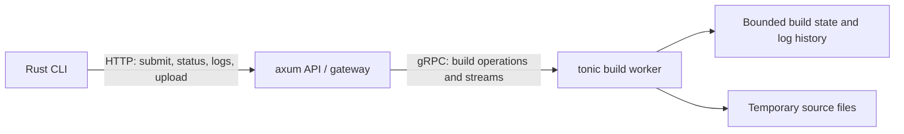

# Pocket CI

Build a tiny CI service in Rust, and learn networking by adding features that a build service actually needs.

Pocket CI is a dummy version of the build submission, status tracking, and live-log portion of a service like GitHub Actions. A developer submits a build, waits for it to finish, follows its logs, and eventually uploads a source bundle through an HTTP gateway to a separate gRPC worker.

**Project status:** design stage. The repository currently contains a Rust starter, not an implemented CI service. The capabilities and CLI examples below describe the target implementation.

## The Product

Each build simulates three stages: checkout, compile, and test. Tokio tasks produce timed logs and finish with either success or an intentional test failure. The simulation makes network behavior observable without needing containers or a compiler toolchain inside the server.

Uploaded source bundles are opaque files. The worker records their size as a simulated build input; it does not unpack them, execute uploaded code, or claim to have tested it.

The final system has three programs:

- A Rust CLI for submitting builds, checking status, following logs, and uploading files.
- An axum HTTP API that evolves into a gateway.
- A tonic gRPC worker that owns build execution and state.



Start with only the CLI and API server. Introduce the worker when separating build execution becomes the next product requirement.

## Build It Incrementally

### 1. Run a Build for Me

Implement `POST /builds` and `GET /builds/{id}`. Start a simulated build asynchronously and inspect its changing status with the CLI.

Learn HTTP methods, JSON request bodies, validation, status codes, and the `Location` header. In particular, `202 Accepted` means the request was accepted, not that the build succeeded.

**Experiment:** submit one successful build and one with intentionally failing tests.

### 2. Tell Me When Something Changes

First check status every second. Then add a long-polling endpoint that holds the request until a newer status version exists or the wait times out.

Learn held HTTP requests, timeouts, reconnecting, version cursors, and Tokio `watch`. Status updates represent the latest snapshot, not a lossless queue of every transition.

**Experiment:** compare request counts for periodic polling and long polling during the same build.

### 3. Show Me Why My Build Is Failing

Stream live build logs as newline-delimited JSON (NDJSON). The CLI prints each line while the build is still running. Add sequence numbers and a small bounded log history so clients can reconnect.

Learn response streaming, application-level framing, incremental body reading, slow consumers, and disconnects. Closing a log viewer must not stop the build.

**Experiment:** disconnect, reconnect from the last sequence number, and observe an explicit gap if the requested history has expired.

### 4. Move Builds Out of the API Server

Extract the same build engine into a separate tonic worker. Add unary RPCs for build operations and a server-streaming RPC for live logs. Allow the CLI to inspect logs directly through gRPC.

Learn protobuf contracts, HTTP/2, streaming RPCs, deadlines, and final gRPC status. The worker becomes the single owner of build state.

**Experiment:** compare native gRPC log messages with the existing HTTP output.

### 5. Keep the Public API HTTP

Connect the existing HTTP endpoints to the worker. Translate each gRPC log message into an NDJSON record and forward it immediately, without collecting the stream first. Preserve the HTTP client's existing workflow.

Learn HTTP-to-gRPC conversion, bounded forwarding, backpressure, cancellation, and upstream errors after HTTP response headers have already been sent.

**Experiment:** stop the worker while a client is following logs. Distinguish a transport failure from a build whose tests failed normally.

### 6. Build This Source Bundle

Upload a file as a streaming HTTP request body. The gateway forwards bounded protobuf chunks through a client-streaming RPC, and the worker writes them incrementally to a temporary file. Submit a build using the receipt returned after a successful upload.

Learn request-body streaming, bounded memory, byte counts, partial uploads, and cleanup. This is sequential upload followed by build submission, not simultaneous bidirectional HTTP streaming.

**Experiment:** interrupt an upload and verify that no usable source receipt or build is created from the partial file.

## Target Workflow

These are proposed CLI commands, not commands available in the current starter:

```text
client submit --label demo
client submit --label failing-demo --fail-tests
client status BUILD_ID --follow
client logs BUILD_ID --follow
client logs BUILD_ID --transport grpc --follow
client submit --label uploaded-demo --source ./source.bundle
```

The complete submission workflow is: upload an optional source file, submit a build, follow status or logs, and report the final build result.

## What "Without Buffering" Means

The gateway must not collect an entire upload or log stream in RAM before forwarding it. It processes bounded messages and uses bounded queues instead.

This does not mean zero buffers, zero copies, or guaranteed immediate delivery. JSON and protobuf need message framing, TCP and HTTP/2 have transport buffers, and the worker deliberately retains a small replay history and writes uploads to disk.

## Scope

Included: simulated builds, an HTTP API and Rust client, long polling, live HTTP logs, native gRPC streaming, incremental HTTP/gRPC translation, and streaming source uploads.

Not included: real compilation, archive extraction, containers, databases, durable recovery, authentication, production deployment, a browser dashboard, gRPC-Web, or a generic gateway framework. The service is a local learning project, not a production CI runner.

## Design and Verification

See [DESIGN.md](DESIGN.md) for architecture, endpoint and RPC contracts, state ownership, Mermaid sequence diagrams, limits, cancellation rules, and milestone acceptance checks.

Tests will demonstrate that the first log reaches a client before a build completes and that the worker writes upload bytes before HTTP EOF. Failure tests will cover malformed requests, polling races, expired history, worker outages, and interrupted uploads.

The tutorial can be published as **Building a Tiny CI Service in Rust**, with one working capability and one failure experiment per chapter. Select appropriate licenses for the code and tutorial text before publication.